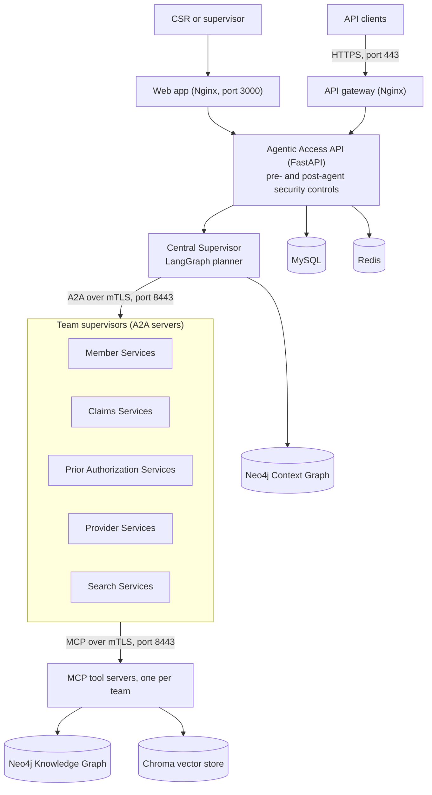

# Health Insurance Customer Service Intelligence Platform (CSIP)

CSIP is a hierarchical, multi-agent AI platform that helps health insurance customer service representatives (CSRs) answer questions about members, claims, prior authorizations, providers and policies. A central LangGraph supervisor plans each request and delegates the work to five specialist teams over the A2A protocol, and each team calls its tools over MCP. Every request passes through ten layered security controls built for handling PHI.

The repository contains the full platform (agents, security controls, data layer, observability, Docker Swarm deployment and a web app) plus standalone learning examples in `chapter3/` through `chapter5/`.

---

## What's new

### October 2026: Guardrails Hub retirement

Guardrails.ai decommissioned the Guardrails Hub, so `guardrails hub install` no longer works and the output-validation layer had to move to a new delivery mechanism. The three Guardrails validators CSIP depends on are now installed as standalone Python packages from PyPI. Merged in [PR #1](https://github.com/kbmurali/customer_service_platform/pull/1).

**What changed**

| Area | Before | After |
|---|---|---|
| Validator source | `guardrails hub install hub://…` at image build time | Pinned PyPI packages: `guardrails-ai-detect-pii==0.0.6`, `guardrails-ai-toxic-language==0.0.2`, `guardrails-ai-restrict-to-topic==0.1.0` |
| Imports | `from guardrails.hub import DetectPII, ToxicLanguage, RestrictToTopic` | `guardrails_ai.detect_pii`, `guardrails_ai.toxic_language`, `guardrails_ai.restricttotopic` |
| Inference | Global `--disable-remote-inferencing` setting | `use_local=True` set on each validator, so inference runs inside the API container |
| Build credentials | `GUARDRAILS_TOKEN` build argument, sourced from `.env` | No token needed; `redeploy.sh` no longer sources `.env` or passes `--build-arg` |
| Model and data caches | Hugging Face cache only | `HF_HOME`, `TORCH_HOME`, `XDG_CACHE_HOME` and `NLTK_DATA` all live under `/app`, readable by the non-root `csip` user |

The image build now also downloads the NLTK `punkt` tokenizer data and runs the DetectPII post-install step, which prepares Presidio's analyzer and anonymizer. The `facebook/bart-large-mnli` zero-shot model used by `RestrictToTopic` is still downloaded at build time.

**Dependency pinning**

Packages that previously used floating `>=` ranges in `requirements.txt` are now pinned to exact versions, so builds are reproducible:

| Group | Pinned versions |
|---|---|
| Core | pydantic 2.13.5, python-dotenv 1.2.3, httpx 0.28.1, aiohttp 3.14.3, mcp 1.30.0, nest_asyncio 1.6.0 |
| Data processing | pandas 2.3.3, numexpr 2.14.1 |
| Security | nh3 0.3.7 |
| Dev and test | pytest 9.1.1, pytest-asyncio 1.4.0, black 26.5.1, flake8 7.3.0, mypy 2.3.1, pysqlite3-binary 0.5.4.post2 |

`guardrails-ai` itself stays at 0.5.13 for compatibility with the LangChain 0.3.x stack.

**Upgrading an existing deployment**

1. Pull `main`.
2. Rebuild and redeploy: `cd deployment && bash redeploy.sh`. Every Python service image installs `requirements.txt`, so all of them pick up the new pins.
3. Remove `GUARDRAILS_TOKEN` from `.env` and from any CI secrets; nothing reads it any more.
4. Check the API logs for `Guards created in full (hub + Presidio) mode`. If you see `Presidio-only (hub not installed)` instead, the validator packages failed to import and only the Presidio-based checks are running.

---

## Architecture



**How a request flows**

1. A CSR submits a question in the web app (or calls `POST /api/agent/query` with a JWT).
2. Pre-agent controls run: circuit-breaker check, NeMo input validation, RBAC, rate limiting, nh3 sanitization, and Presidio vaulting of PII/PHI.
3. The **Central Supervisor** builds a plan of goals and steps, enriched with similar past successes from the experience store, and records it in the Context Graph.
4. Each step is sent as an encrypted A2A task to the right **team supervisor**, which runs its own LangGraph workers. Workers call tools on the team's **MCP tool server**, which enforces per-role tool permissions and rate limits.
5. Write operations (updating a member or claim, approving or denying a prior authorization) pause for **human approval**.
6. Post-agent controls validate the answer with Guardrails AI, run a DLP scan, and write the audit log before the response is returned.

All internal service-to-service traffic goes through the Nginx gateway on port 8443, which requires a client certificate. Port 443 serves external HTTPS traffic without mTLS, and the API enforces JWT authentication.

### Agent teams and tools

The platform exposes 23 tools across five teams. Tools marked **HITL** change data and require human approval before they run.

| Team | Tools |
|---|---|
| Member Services | `member_lookup`, `check_eligibility`, `coverage_lookup`, `member_policy_lookup`, `treatment_history`, `update_member_info` (HITL) |
| Claims Services | `claim_lookup`, `claim_status`, `claim_payment_info`, `member_claims`, `update_claim_status` (HITL) |
| Prior Authorization Services | `pa_lookup`, `pa_status`, `pa_requirements`, `member_prior_authorizations`, `approve_prior_auth` (HITL), `deny_prior_auth` (HITL) |
| Provider Services | `provider_lookup`, `provider_network_check`, `provider_search_by_specialty` |
| Search Services | `search_knowledge_base`, `search_medical_codes`, `search_policy_info` |

Each team publishes an A2A Agent Card at `/.well-known/agent.json`, which the Central Supervisor uses for discovery and skill-based routing. The API image also bundles every team's card as a local fallback when a remote team is unreachable.

### Security controls

The ten controls below each have a matching unit test file in `tests/unit/`.

| # | Control | Implementation |
|---|---|---|
| 1 | Input validation (prompt injection) | NeMo Guardrails self-check rails and Colang dialog flows (`security/nemo_guardrails_integration.py`, `security/config/`) |
| 2 | Authentication and RBAC | JWT login, role and tool permissions stored in MySQL (`agents/security.py`) |
| 3 | Input sanitization | nh3 strips HTML to prevent XSS (`security/nh3_sanitization.py`) |
| 4 | Memory and context security | Presidio detects PII/PHI with healthcare-specific recognizers and replaces it with reversible, encrypted vault tokens before it reaches memory or the graphs (`security/presidio_*.py`) |
| 5 | Human-in-the-loop and kill switch | Approval queue for write tools and an emergency circuit breaker, backed by Redis and MySQL (`security/approval_workflow.py`) |
| 6 | Rate limiting | A per-user request limit plus per-role, per-tool limits from the `tool_permissions` table |
| 7 | Audit logging | Every login, request and approval is written to MySQL `audit_logs` |
| 8 | Inter-agent message security | mTLS at the gateway, plus AES-256-GCM encryption, HMAC-SHA256 signing, HKDF per-agent-pair keys and nonce/timestamp replay protection (`security/message_encryption.py`) |
| 9 | Output validation and DLP | Guardrails AI (`DetectPII`, `ToxicLanguage`, `RestrictToTopic`, plus a custom Presidio-backed HIPAA validator), followed by a DLP scan that classifies sensitivity and writes an audit record to ClickHouse (`security/guardrails_output_validation.py`, `security/dlp_scanner.py`) |
| 10 | Observability | Langfuse traces, Prometheus metrics and Grafana dashboards (`observability/`) |

An optional token budget control (`agents/core/budget_controller.py`) enforces daily per-role token limits. It is off by default; set `TOKEN_BUDGET_ENFORCEMENT_ENABLED=true` to turn it on.

### Data stores

| Store | Used for |
|---|---|
| Neo4j Knowledge Graph | Members, policies, providers, claims, prior authorizations and treatment records |
| Neo4j Context Graph | Sessions, plans, goals, steps and agent executions, for traceability across follow-up questions |
| MySQL | Users, roles and permissions, audit logs, approvals, feedback, metrics and token budgets (`databases/mysql_schema.sql`) |
| Chroma | Policy, procedure, diagnosis, FAQ and clinical guideline collections, plus the `successful_experiences` collection used for few-shot planning |
| Redis | Circuit breaker, approval queue, rate limits, the PII/PHI vault (DB 2) and aggregated metrics (DB 3) |
| ClickHouse, PostgreSQL, MinIO | Back end for the self-hosted Langfuse instance; ClickHouse also stores DLP audit records |

### Learning from feedback

CSRs rate answers in the web app. A background pipeline (`observability/evaluation_pipeline.py`) runs every 30 seconds to compute quality metrics. Sessions rated correct are extracted into the experience store and reused as few-shot planning examples. Low-rated sessions are clustered by team and failure type into improvement reports (`observability/feedback_pattern_analyzer.py`). Prompts are versioned in Langfuse, so they can be changed and rolled back without a code release.

### LLM providers

`llm_providers/llm_provider_factory.py` returns an OpenAI, Anthropic or AWS Bedrock chat model based on `LLM_PROVIDER` and `LLM_MODEL`. If `LLM_PROVIDER_FALLBACK_CHAIN` is set (for example `openai,anthropic`), a Redis-backed circuit breaker switches to the next provider automatically when the primary one keeps failing. Conversation history and retrieved context can be compressed with LLMLingua before being sent to the model (`CONTEXT_COMPRESSION_*` settings).

### Web app

The single-page React app (`webapp/index.html`, served by Nginx with no build step) has five views:

| View | Purpose |
|---|---|
| CSR Workspace | Ask questions, see the execution path and tool results, and rate answers |
| Context Graph | Explore a session's plan, goals, steps and executions |
| Performance | Agent latency, error rates, planning accuracy and LLM usage |
| Control Pane | Approval queue, circuit breaker, and tool permission management |
| Feedback Learning | Feedback trends, extracted experiences and improvement reports |

---

## Repository layout

```
agents/
  agentic_access_http_api.py   FastAPI entry point (login, query, feedback, stats, admin)
  request_processor.py         Security pipeline around the agent graph
  central_supervisor.py        Top-level planner and router
  core/                        A2A client, agent cards, Context Graph, compression, budgets
  teams/<team>/                Team supervisor, workers, A2A server and MCP tool server
security/                      The security controls and their configuration
databases/                     Neo4j, MySQL and Chroma data access, MySQL schema
llm_providers/                 Provider factory and failover circuit breaker
observability/                 Langfuse, Prometheus, evaluation and feedback pipelines
config/settings.py             Central settings, read from environment variables
data/                          Sample data loader and seeding scripts
deployment/                    Dockerfiles, Swarm compose files, Nginx configs, scripts
webapp/                        Single-page web app
tests/                         Unit, integration, functional and evaluation suites
chapter3/ … chapter5/          Standalone learning examples (see below)
```

---

## Getting started

### Prerequisites

- Docker with Swarm mode (`docker swarm init` on a single machine is enough)
- Python 3.11 on the host, for loading sample data and running tests
- An OpenAI API key (the default provider, also used for Chroma embeddings)
- A certificate authority, plus a server certificate for the gateway and a client certificate signed by it. Services connect to the gateway as `api-gateway`, and local tests connect as `localhost`, so the server certificate needs both names as subject alternative names.
- Enough memory for the stack; the API container alone is limited to 4 GB because it loads spaCy, Presidio, NeMo Guardrails and the Guardrails models.

### 1. Configure the environment

```bash
git clone https://github.com/kbmurali/customer_service_platform.git
cd customer_service_platform
cp .env.example .env    # then fill in keys and passwords
pip install -r requirements.txt
```

`.env` is used by scripts and tests that run on the host. Services running in the stack read their configuration from the compose files and Docker secrets.

### 2. Create Docker secrets

The stack expects 25 external secrets:

| Group | Secrets |
|---|---|
| LLM providers | `OPENAI_API_KEY`, `ANTHROPIC_API_KEY`, `AWS_ACCESS_KEY_ID`, `AWS_SECRET_ACCESS_KEY` |
| Databases | `NEO4J_KG_PASSWORD`, `NEO4J_CG_PASSWORD`, `MYSQL_ROOT_PASSWORD`, `MYSQL_PASSWORD`, `CLICKHOUSE_PASSWORD` |
| Application | `SECRET_KEY` (JWT signing), `VAULT_ENCRYPTION_KEY` (Fernet key), `MCP_MASTER_SECRET` |
| mTLS | `MCP_CA_CERT`, `MCP_SERVER_CERT`, `MCP_SERVER_KEY`, `MCP_CLIENT_CERT`, `MCP_CLIENT_KEY` |
| Langfuse and Grafana | `LANGFUSE_DB_PASSWORD`, `LANGFUSE_NEXTAUTH_SECRET`, `LANGFUSE_SALT`, `LANGFUSE_ENCRYPT_KEY`, `MINIO_ROOT_PASSWORD`, `GRAFANA_ADMIN_PASSWORD`, `LANGFUSE_PUBLIC_KEY`, `LANGFUSE_SECRET_KEY` |

The application services reference the Anthropic and AWS secrets even when you only use OpenAI, so create them with placeholder values if needed. Create the two Langfuse API key secrets in step 3, after Langfuse is running.

```bash
docker swarm init

# Text values
printf '%s' 'your-value' | docker secret create MYSQL_ROOT_PASSWORD -
openssl rand -hex 32 | tr -d '\n' | docker secret create LANGFUSE_ENCRYPT_KEY -
python -c "from cryptography.fernet import Fernet; print(Fernet.generate_key().decode(), end='')" \
  | docker secret create VAULT_ENCRYPTION_KEY -

# Certificate files
docker secret create MCP_CA_CERT     certs/ca.crt
docker secret create MCP_SERVER_CERT certs/server.crt
docker secret create MCP_SERVER_KEY  certs/server.key
docker secret create MCP_CLIENT_CERT certs/client.crt
docker secret create MCP_CLIENT_KEY  certs/client.key
```

Use the same database passwords in `.env` so that host-side scripts can connect.

### 3. Start the infrastructure and set up Langfuse

From the repository root:

```bash
cd deployment
docker build -f Dockerfile.chroma -t chroma-with-curl:latest .
docker stack deploy -c docker-compose-v2.yml health_insurance
```

Open Langfuse at http://localhost:3001, create a project and an API key pair, then register the keys:

```bash
printf '%s' 'pk-lf-…' | docker secret create LANGFUSE_PUBLIC_KEY -
printf '%s' 'sk-lf-…' | docker secret create LANGFUSE_SECRET_KEY -
```

### 4. Load sample data

Once Neo4j, MySQL and Chroma are healthy:

```bash
cd ../data              # from deployment/
python load_sample_data.py
```

This generates synthetic members, policies, providers, claims, prior authorizations and treatment records, and loads them into Neo4j, MySQL and Chroma. It reads connection settings from the repository's `.env` and saves a copy of the data to `sample_data.json`.

### 5. Build and deploy the full stack

```bash
cd ../deployment     # from data/
bash redeploy.sh     # rebuilds every image and redeploys the stack; data volumes are kept
bash seed_data.sh    # seeds Langfuse prompts and the experience store
```

Later restarts without rebuilding can use `start_services.sh`, and `stop_services.sh` removes the stack. Check service status with `docker stack services health_insurance`. The API has a long health-check start period (6 minutes) because it loads several ML models on startup.

### 6. Sign in

Open the web app at http://localhost:3000. The schema seeds these demo users, all with the password `testuser`:

| Username | Role | Access |
|---|---|---|
| `jthompson` | `CSR_READONLY` | Read tools only, with lower rate limits |
| `mgarcia`, `dkim` | `CSR_TIER1` | Read tools only |
| `rpatel`, `swilson` | `CSR_TIER2` | Read tools plus the write tools, which still need approval |
| `jchen`, `lnguyen` | `CSR_SUPERVISOR` | All tools and permissions |

Change these credentials before using the stack anywhere other than a local machine.

### Service endpoints

| Service | Address |
|---|---|
| Web app | http://localhost:3000 |
| Agentic Access API (via gateway) | https://localhost/agentic/access |
| Internal MCP and A2A traffic (mTLS) | https://localhost:8443 |
| Langfuse | http://localhost:3001 |
| Grafana | http://localhost:3002 |
| Prometheus | http://localhost:9090 |
| Neo4j Knowledge Graph browser / Bolt | http://localhost:7474, bolt://localhost:7687 |
| Neo4j Context Graph browser / Bolt | http://localhost:7475, bolt://localhost:7688 |
| MySQL, Redis, Chroma | localhost:3306, localhost:6379, localhost:8000 |

---

## API overview

All endpoints except `/api/auth/login`, `/health` and `/metrics` require `Authorization: Bearer <token>`. Through the gateway, prefix each path with `/agentic/access`.

| Endpoint | Purpose |
|---|---|
| `POST /api/auth/login` | Exchange a username and password for a JWT |
| `POST /api/agent/query` | Ask a question; returns the answer, execution path and tool results |
| `POST /api/feedback`, `GET /api/feedback/patterns`, `/api/feedback/improvements` | Rate answers and review improvement reports |
| `GET /api/cg/session/{session_id}` | Context Graph view of a session |
| `GET /api/stats/*` | Agent health, team invocations, rate-limit use and tool usage |
| `GET/POST /api/admin/circuit-breaker` | Read or toggle the emergency stop |
| `GET /api/admin/approval-queue`, `POST /api/admin/approval-resolve` | Review and resolve pending write operations |
| `GET /api/admin/tool-catalog`, `GET/PUT /api/admin/tool-permissions` | Inspect and change per-role tool access |
| `GET /health`, `GET /metrics` | Liveness probe and Prometheus metrics |

---

## Testing

| Suite | Command | Needs |
|---|---|---|
| Unit (the ten security controls) | `pytest -c pytest_unit.ini` | Python dependencies only |
| Integration (API and each team's A2A server) | `pytest -c pytest_integration.ini` | Running stack; override the URL with `AGENTIC_API_URL` |
| Functional (routing, admin endpoints, end-to-end scenarios) | `pytest -c pytest_functional.ini` | Running stack and `pytest-timeout`; override the URL with `CSIP_API_BASE` |
| AI evaluations (faithfulness, adversarial security, regression gates) | `bash setup-eval-venv.sh` then `pytest tests/evals/ -s -v --timeout=300` | Running stack and DeepEval |

---

## Learning examples

The `chapter*` folders are self-contained scripts that build up the ideas used in the platform:

| Folder | Topics |
|---|---|
| `chapter3/` | Tools, ReAct agents, vector-backed agents, agent evaluation, error handling, conversation history, LangSmith tracing, and an MCP server and client |
| `chapter4/` | Multi-agent orchestration patterns: chain of agents, tree of thoughts, handoff, supervisor network, Magentic-style orchestration, sequential, hierarchical network and semantic consensus |
| `chapter5/` | Context engineering with graphs: context graphs, Cypher- and GraphQL-driven context, knowledge-graph context evaluation and a RAG 2.0 example |

---

## License

Licensed under the [Apache License 2.0](LICENSE).
